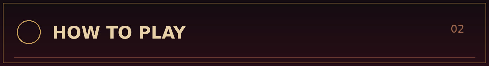
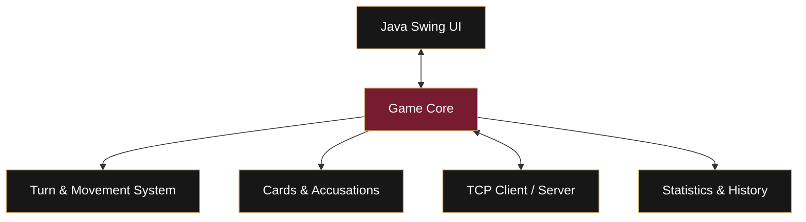

<div align="center">


<br>

**ONE MURDER. SIX SUSPECTS. ONE TRUTH.**

*An atmospheric multiplayer detective board game built with Java and Swing.*

[](https://www.java.com/)


[The Case](#the-case) · [Gameplay](#gameplay) · [Gallery](#gallery) · [Architecture](#architecture) · [Installation](#installation) · [Roadmap](#roadmap) · [Team](#team)

</div>

---

<a id="the-case"></a>
<div align="center">


*Every suspect has a secret. Every clue tells a story.*
</div>

A mysterious murder has shaken the **University of Deusto**. Step into the role of a detective, investigate the board, examine the cards, and piece together the truth before your opponents.

Your mission is simple: discover **who** committed the crime, **where** it happened, and **which weapon** was used.

<table>
<tr>
<td width="33%" align="center"><strong>INVESTIGATE</strong><br><sub>Explore the board and examine the evidence.</sub></td>
<td width="33%" align="center"><strong>DEDUCE</strong><br><sub>Rule out suspects, rooms and weapons.</sub></td>
<td width="33%" align="center"><strong>ACCUSE</strong><br><sub>Make your final accusation.</sub></td>
</tr>
</table>

<div align="center"></div>

<a id="gameplay"></a>
<div align="center">


*Follow the clues. Eliminate the impossible. Uncover the truth.*
</div>

<table>
<tr>
<td width="50%" valign="top"><h3>01 · Join the Investigation</h3>Join a multiplayer session and prepare to investigate with other detectives.</td>
<td width="50%" valign="top"><h3>02 · Roll & Move</h3>Take turns, roll two dice, and move across the board.</td>
</tr>
<tr>
<td width="50%" valign="top"><h3>03 · Examine the Evidence</h3>Use your cards and detective notes to eliminate impossible combinations.</td>
<td width="50%" valign="top"><h3>04 · Solve the Case</h3>Identify the suspect, weapon and room, then make your accusation.</td>
</tr>
</table>

> **Development note:** The project is under active development. Some multiplayer and gameplay features may not yet be fully integrated or tested end to end.

<div align="center"></div>

<a id="gallery"></a>
<div align="center">


*A glimpse behind the investigation.*
</div>

<!-- Add this gallery when all three real screenshots exist in docs/assets/screenshots/.
<table>
<tr>
<td width="50%" align="center"><br><b>01 / MAIN MENU</b></td>
<td width="50%" align="center"><br><b>02 / MULTIPLAYER LOBBY</b></td>
</tr>
</table>
<div align="center"><br><b>03 / THE INVESTIGATION BOARD</b></div>
-->

<p align="center"><em>Gameplay screenshots will be added as the interface is finalized.</em></p>

<div align="center"></div>

<a id="architecture"></a>
<div align="center">


*The engineering behind the mystery.*


</div>

DeustoMurder uses an object-oriented, modular structure to separate user interface, game rules, networking and supporting services.



### Main components

| Area | Examples | Responsibility |
|:--|:--|:--|
| Game core | `Game`, `GameState`, `GameSetup` | Game lifecycle and shared state |
| Turns | `RoundManager`, `MoveValidator` | Turn order and legal movement |
| Cards | `DeckManager`, `AccusationValidator` | Distribution and solution checking |
| Networking | `Client`, `GameServer` | Multiplayer communication |
| Services | `StatisticsManager`, `GameHistory` | Player statistics and event records |
| Interface | `MainScreen`, `LobbyScreen`, `InGameScreen` | Desktop screens |

<details>
<summary><strong>View a simplified source layout</strong></summary>

```text
innerProy/
└── src/
    ├── game/
    │   ├── core/
    │   ├── turns/
    │   ├── cards/
    │   ├── accusations/
    │   └── history/
    ├── networking/
    └── ui/
```

The directory layout is illustrative; consult the repository for the latest package structure.
</details>

<div align="center"></div>

<a id="installation"></a>
<div align="center">


*Every investigation begins somewhere.*
</div>

### Requirements

- A **JDK** compatible with the project source code.
- **IntelliJ IDEA** (recommended).
- **Git** to clone the repository.

### 01 · Clone

```bash
git clone https://github.com/Finse2/DeustoMurder.git
cd DeustoMurder
```

### 02 · Configure

1. Open the cloned folder in **IntelliJ IDEA**.
2. Configure the project SDK under **File → Project Structure**.
3. If necessary, mark `innerProy/src` as **Sources Root**.
4. Locate the class containing the application's `public static void main(String[] args)` entry point and run it.

> The exact JDK version and entry-point class should be verified against the current repository before publishing release instructions.

<details>
<summary><strong>Troubleshooting</strong></summary>

- **JDK not configured:** Select a compatible SDK in IntelliJ's Project Structure.
- **Sources not recognized:** Mark the source directory as *Sources Root*.
- **Resources missing:** Check the resource paths and working directory in the run configuration.
- **Multiplayer connection fails:** Verify the host is running, the network is reachable, and the firewall permits the required connection.
</details>

<div align="center"></div>

<a id="roadmap"></a>
<div align="center">


*Building the mystery, one commit at a time.*
</div>

The following checklist describes the project's development areas. **Confirm the completion markers against the current code and tests before publishing.**

- [x] Core game model and state management components
- [x] Turn, movement, deck and accusation logic components
- [x] Initial Java Swing screens and networking foundations
- [ ] Fully integrated and tested multiplayer game flow
- [ ] Complete achievements integration
- [ ] Save/load and persistent game history
- [ ] End-to-end tests, stability improvements and release packaging

<div align="center"></div>

<a id="team"></a>
<div align="center">


*Four developers. One investigation.*
</div>

Developed as a student project at the **University of Deusto**.

| Developer | Primary focus |
|:--|:--|
| **David** | Game logic, backend and gameplay systems |
| **Andrada** | Multiplayer lobby and player experience |
| **Antal** | Board and interface components |
| **Luka** | Main interface and board visualization |

<div align="center">

[**View repository contributors**](https://github.com/Finse2/DeustoMurder/graphs/contributors)

</div>

<div align="center"></div>

<div align="center">


### THE CASE IS NEVER TRULY CLOSED.

*Every mystery leaves a trace.*

[](https://github.com/Finse2/DeustoMurder)
[](https://github.com/Finse2/DeustoMurder/issues)
[](https://github.com/Finse2/DeustoMurder/graphs/contributors)

<sub>DEUSTO MURDER · UNIVERSITY OF DEUSTO · 2026</sub>

</div>
