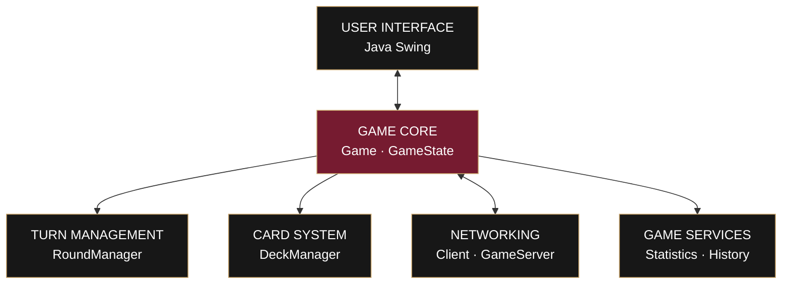

<div align="center">


<h3>THE MYSTERY BEGINS HERE</h3>

<p>
  <em>One murder. Six suspects. One truth.</em>
</p>

<p>
  An immersive multiplayer murder mystery
  built with Java & Swing.
</p>

<p>
  
  
  
  
</p>

</div>

<div align="center">
<a href="#the-case">THE CASE</a> · <a href="#how-to-play">GAMEPLAY</a> · <a href="#inside-the-mystery">GALLERY</a> · <a href="#under-the-hood">TECH</a> · <a href="#getting-started">INSTALL</a> · <a href="#development-roadmap">ROADMAP</a>
</div>

<p align="center"></p>
<!-- CASE FILE -->

<div align="center">


<a id="the-case"></a>


<p><em>Every suspect has a secret. Every clue tells a story.</em></p>

</div>

A mysterious murder has shaken the **University of Deusto**.
Behind its historic walls lies a mystery waiting to be solved.

Step into the role of a detective, explore the crime scene,
examine the evidence, and uncover the truth before anyone else.

**The question is simple: Who committed the murder, where, and with what weapon?**

<br>

<table>
<tr>
<td align="center" width="33%">
  <h3>INVESTIGATE</h3>
  <p>Explore the mystery and gather evidence.</p>
</td>
<td align="center" width="33%">
  <h3>DEDUCE</h3>
  <p>Connect the clues and eliminate suspects.</p>
</td>
<td align="center" width="33%">
  <h3>ACCUSE</h3>
  <p>Make your final accusation and reveal the truth.</p>
</td>
</tr>
</table>

<br>

<div align="center">
  <sub>DEUSTO MURDER | INVESTIGATION FILE 001</sub>
</div>

<p align="center"></p>
<!-- GAMEPLAY SECTION -->

<div align="center">


<a id="how-to-play"></a>


<p><em>Follow the clues. Eliminate the impossible. Uncover the truth.</em></p>

</div>

<br>

<table>
<tr>
<td width="50%" valign="top">

<h3>01 — JOIN THE GAME</h3>

Enter an investigation alongside other detectives.

Prepare to uncover the secrets hidden within Deusto.

</td>
<td width="50%" valign="top">

<h3>02 — ROLL & MOVE</h3>

Roll the dice and navigate the game board.

Explore different locations as the investigation unfolds.

</td>
</tr>
<tr>
<td width="50%" valign="top">

<h3>03 — COLLECT CLUES</h3>

Examine your cards and keep track of the evidence.

Use your detective notes to eliminate possibilities.

</td>
<td width="50%" valign="top">

<h3>04 — SOLVE THE CASE</h3>

Connect the evidence and make your final accusation.

Identify the suspect, the weapon, and the room.

</td>
</tr>
</table>

<br>

<div align="center">

<h3>THREE ANSWERS. ONE SOLUTION.</h3>

<p>
  <code>SUSPECT</code>
  &nbsp;&bull;&nbsp;
  <code>WEAPON</code>
  &nbsp;&bull;&nbsp;
  <code>ROOM</code>
</p>

<sub>DEUSTO MURDER | INVESTIGATION PROTOCOL 002</sub>

</div>

<p align="center"></p>
<!-- GAME GALLERY: Add real screenshots to docs/assets/screenshots/ before publishing this section. -->

<div align="center">


<a id="inside-the-mystery"></a>


<p><em>A glimpse behind the investigation.</em></p>

</div>

<br>

<table>
  <tr>
    <td width="50%" align="center">
      
      <br>
      <b>01 / MAIN MENU</b>
      <br>
      <sub>Where every mystery begins.</sub>
    </td>
    <td width="50%" align="center">
      
      <br>
      <b>02 / MULTIPLAYER LOBBY</b>
      <br>
      <sub>Gather your fellow detectives.</sub>
    </td>
  </tr>
</table>

<br>

<div align="center">


<p><b>03 / THE INVESTIGATION BOARD</b></p>

<p><sub>Every room hides a secret. Every move matters.</sub></p>

</div>

<br>

<div align="center">
  <sub>DEUSTO MURDER | VISUAL EVIDENCE 003</sub>
</div>

<p align="center"></p>
<!-- TECH STACK -->

<div align="center">


<a id="under-the-hood"></a>


<p><em>The engineering behind the mystery.</em></p>

<p>
  A modular desktop game built with object-oriented
  programming, custom networking and Java Swing.
</p>

<br>


<br><br>


</div>

<br>


### System Architecture

The project follows a modular architecture that separates
the graphical interface, game logic, networking, and
supporting services.




### Project Structure

```text
DeustoMurder/
├── README.md
├── docs/assets/             # README visual assets
└── innerProy/
    ├── src/
    │   ├── activation/      # Main menu and lobby
    │   ├── app/             # Application entry point
    │   ├── game/            # Core, cards, turns, history, statistics
    │   ├── model/           # Players, rooms, weapons, board
    │   ├── ui/              # Swing screens and rendering
    │   └── utils/           # Shared utilities and JDBC
    ├── networking/src/      # Client, server, packets
    └── ressources/          # Game media and images
```

<br>

<div align="center">

  <sub>
    DEUSTO MURDER | TECHNICAL DOSSIER 004
  </sub>

</div>

<p align="center"></p>
<!-- GETTING STARTED -->

<div align="center">


<a id="getting-started"></a>


<p><em>Every investigation begins somewhere.</em></p>

<p>Follow these steps to set up DeustoMurder on your computer.</p>

</div>

### 01 — Prerequisites

Before launching the investigation, make sure you have:

- **Java Development Kit (JDK)** — a version compatible with the project.
- **IntelliJ IDEA** — recommended development environment.
- **Git** — to clone the repository.

### 02 — Clone the Repository

Open a terminal and run:

```bash
git clone https://github.com/Finse2/DeustoMurder.git
cd DeustoMurder
```

### 03 — Configure the Project

1. Open **IntelliJ IDEA**.
2. Select `File > Open`.
3. Choose the cloned `DeustoMurder` directory.
4. Configure the project's **JDK** in Project Structure.
5. Ensure `innerProy/src` is recognized as a source directory.

### 04 — Launch the Game

1. Navigate to `innerProy/src/app/Main.java`.
2. Open the application entry point.
3. Run the `main()` method.
4. The game interface should appear.

> **Note:** DeustoMurder is under active development.
> Some gameplay and multiplayer features may be incomplete.

<br>

<div align="center">

<b>THE INVESTIGATION IS READY TO BEGIN.</b>

<br><br>

<sub>DEUSTO MURDER | DEPLOYMENT PROTOCOL 005</sub>

</div>

<details>
<summary><b> Troubleshooting — Common Issues</b></summary>

<br>

**Java SDK not configured**

Open `File > Project Structure > Project` and select a compatible JDK.

**Source files not recognized**

Right-click `innerProy/src` in IntelliJ and select:

`Mark Directory as > Sources Root`

**Application does not start**

Verify that your Java version is compatible, the
main class is correctly configured, and the required
project resources are available.

**Multiplayer connection fails**

Ensure both players can communicate over the network,
that the host is running, and that the required port
is not blocked by the firewall.

</details>

<p align="center"></p>


<!-- DEVELOPMENT ROADMAP -->

<div align="center">


<a id="development-roadmap"></a>


<p><em>Building the mystery, one commit at a time.</em></p>

<p>
  Follow the evolution of DeustoMurder,
  from its core game systems to a complete
  multiplayer detective experience.
</p>

</div>

<br>

### 01 — Core Systems

The foundations of the investigation.

- [x] Game engine and state management
- [x] Turn management system
- [x] Dice and movement validation
- [x] Card deck and distribution logic
- [x] Accusation validation
- [x] Player statistics infrastructure

### 02 — Multiplayer & Integration

Connecting detectives across the network.

- [x] Client and server foundations
- [ ] Complete multiplayer game flow
- [ ] Synchronization of game state
- [ ] Robust connection error handling
- [ ] Full multiplayer testing

### 03 — Gameplay Enhancements

Making every investigation more immersive.

- [ ] Complete achievements integration
- [ ] Save and load game functionality
- [ ] Persistent game history
- [ ] Complete sound and settings integration
- [ ] Final interface polish

### 04 — Final Release

Preparing the investigation for everyone.

- [ ] Automated and integration testing
- [ ] Performance optimization
- [ ] Bug fixing and stabilization
- [ ] Complete documentation
- [ ] Stable playable release

<br>

<div align="center">


<br><br>

<sub>DEUSTO MURDER | PROJECT INTELLIGENCE 006</sub>

</div>


<details>
<summary><b>Explore the development milestones</b></summary>

<br>

<table>
<tr>
<th>System</th>
<th>Core components</th>
</tr>

<tr>
<td>Game Engine</td>
<td>Game, GameState, GameSetup</td>
</tr>

<tr>
<td>Turn Management</td>
<td>RoundManager, MoveValidator</td>
</tr>

<tr>
<td>Card System</td>
<td>DeckManager, AccusationValidator</td>
</tr>

<tr>
<td>Networking</td>
<td>Client, GameServer</td>
</tr>

<tr>
<td>Statistics</td>
<td>StatisticsManager, PlayerStatistics</td>
</tr>

<tr>
<td>Game History</td>
<td>GameHistory, GameEvent</td>
</tr>
</table>

</details>


<p align="center"></p>
<!-- DEVELOPMENT TEAM -->

<div align="center">


<a id="the-team"></a>


<p><em>Four developers. One investigation.</em></p>

<p>
  Created by a team of Data Science and Artificial
  Intelligence students at the University of Deusto.
</p>

</div>

<br>

<table>
<tr>
<td width="50%" align="center" valign="top">

<h3>01 / DAVID</h3>
<sub>GAME LOGIC & BACKEND</sub>

<br><br>

Game architecture, turn management, card systems,
statistics and gameplay logic.

</td>
<td width="50%" align="center" valign="top">

<h3>02 / ANDRADA</h3>
<sub>MULTIPLAYER LOBBY</sub>

<br><br>

Lobby interface, player management
and multiplayer session experience.

</td>
</tr>
<tr>
<td width="50%" align="center" valign="top">

<h3>03 / ANTAL</h3>
<sub>BOARD & COMPONENTS</sub>

<br><br>

Board components, interface elements
and game board integration.

</td>
<td width="50%" align="center" valign="top">

<h3>04 / LUKA</h3>
<sub>USER INTERFACE</sub>

<br><br>

Main menu, board visualization
and graphical interface components.

</td>
</tr>
</table>

<br>

<div align="center">

<a href="https://github.com/Finse2/DeustoMurder/graphs/contributors">
  
</a>

<br><br>

<sub>DEUSTO MURDER | PERSONNEL DOSSIER 007</sub>

</div>

<p align="center"></p>
<!-- FINAL VERDICT -->

<div align="center">


<br><br>

<a id="final-verdict"></a>


<p><em>Every mystery leaves a trace.</em></p>

<br>

<a href="https://github.com/Finse2/DeustoMurder">
  
</a>

<a href="https://github.com/Finse2/DeustoMurder/issues">
  
</a>

<a href="https://github.com/Finse2/DeustoMurder/graphs/contributors">
  
</a>

<br><br>

<p>
  Developed with dedication by students
  of the University of Deusto.
</p>

<p>
  <sub>DEUSTO MURDER · 2026</sub>
</p>

<p>
  <sub>
    Built with Java & Swing.
    Designed for curious minds.
  </sub>
</p>

</div>

