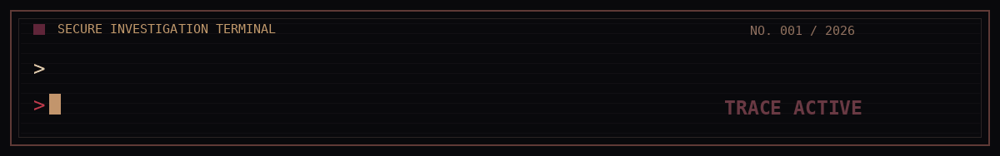

<div align="center">



<br />



<br /><br />

**ONE MURDER. SIX SUSPECTS. ONE TRUTH.**

*A multiplayer detective board game inspired by Cluedo — built with Java and Swing.*

[The Case](#the-case) · [Investigation](#the-investigation) · [Evidence](#the-evidence) · [Architecture](#architecture) · [Installation](#installation) · [Development](#development) · [Team](#the-team)

</div>

---

<a id="the-case"></a>
<div align="center">
  
</div>

A mysterious crime has shaken the **University of Deusto**. The halls are quiet, the suspects are many, and the evidence is incomplete. Each player becomes a detective, gathering clues and eliminating possibilities before making a final accusation.

The objective is to identify the **suspect**, **weapon**, and **room** hidden in the sealed solution.

<div align="center">
  
  <sub>Atmospheric concept art created for this README — not an in-game screenshot.</sub>
</div>

<a id="the-investigation"></a>
<div align="center">
  
</div>

| Act | The investigation |
|:--|:--|
| **I — Gather** | Join or host a session and prepare the investigation. |
| **II — Explore** | Take turns, roll dice, and move through the board. |
| **III — Deduce** | Study the cards, track revealed information, and eliminate impossible combinations. |
| **IV — Accuse** | Choose a suspect, a weapon, and a room to test your theory. |

> **Development status:** DeustoMurder is an evolving student project. Its game model, Swing UI, and networking components exist, but the full multiplayer gameplay flow is still being integrated and tested. These steps describe the intended player experience, not a claim that every step is release-ready.

<a id="the-evidence"></a>
<div align="center">
  
  
</div>

At the start of a game, one card from each category forms the secret solution. The remaining cards are shuffled and distributed to players; unassigned cards are publicly visible clues.

<details>
<summary><strong>Open the evidence archive — suspects, weapons & rooms</strong></summary>

**Suspects:** Garaizar, Luka, David, Andrada, Antal, Bringas.

**Weapons:** Machete, chalk, keyboard, cable, chair, screwdriver.

**Rooms:** CRAI, bathrooms, cafeteria, machine room, laboratories, DeustoTech, E208 classroom, dean's office, sports centre.

*Names and locations reflect the project's documented game setup and may evolve.*
</details>

<div align="center"></div>

<a id="architecture"></a>
<div align="center">
  
</div>

A **modular Java architecture** separates the visual experience, gameplay rules, card deduction, multiplayer communication, and supporting game services. The modules below are present in the repository; the diagram is a high-level conceptual representation, not a verified runtime dependency map.

<div align="center">
  
</div>

| Layer | Technologies & relevant classes |
|:--|:--|
| **Application / UI** | Java Swing · `app.Main` · `MainScreen` · `LobbyScreen` · `InGameScreen` |
| **Game engine** | `Game` · `GameState` · `GameSetup` · `GameInitializer` |
| **Turn management** | `RoundManager` · `MoveValidator` · `TurnTimerThread` · `Dice` |
| **Cards & deduction** | `DeckManager` · `AccusationValidator` |
| **Multiplayer** | TCP sockets · `Client` · `GameServer` · serialized packets |
| **Services** | `GameHistory` · `StatisticsManager` · background event-processing threads |

<details>
<summary><strong>Explore the source structure</strong></summary>

```text
DeustoMurder/
├── innerProy/
│   ├── src/
│   │   ├── app/                  # Application entry point
│   │   ├── game/                 # Core, turns, cards, history, stats
│   │   ├── model/                # Players, pieces, cards, rooms
│   │   ├── ui/                   # Board and game screens
│   │   └── activation/Screen/    # Main menu and lobby UI
│   ├── networking/src/          # Networking module
│   └── ressources/              # UI assets (folder name as in repo)
├── docs/assets/noir/           # README visual system
└── README.md
```

This is a selective directory map, not a complete file inventory.

</details>

<a id="installation"></a>
<div align="center">
  
</div>

### Prerequisites

- Java Development Kit (**JDK**) compatible with the checked-out sources.
- **IntelliJ IDEA** (recommended), with an SDK configured.
- Git, to obtain the repository.

### 01 — Clone

```bash
git clone https://github.com/Finse2/DeustoMurder.git
cd DeustoMurder
```

### 02 — Open in IntelliJ IDEA

1. Open the cloned repository in IntelliJ IDEA.
2. Select a compatible JDK under **File → Project Structure → Project SDK**.
3. If IntelliJ does not detect source directories automatically, mark `innerProy/src` as **Sources Root** and configure the separate networking module as needed.
4. Run **`app.Main`** (`innerProy/src/app/Main.java`). The entry point creates the main Swing menu.

> **Note:** The project's exact JDK level and multiplayer runtime configuration should be checked against your local setup. This README does not claim a tested one-command build or a published binary release.

<details>
<summary><strong>Troubleshooting</strong></summary>

| Symptom | Check |
|:--|:--|
| Classes are not found | Project SDK, Sources Root, module dependencies |
| Interface resources are missing | Working directory and `innerProy/ressources` paths |
| Multiplayer connection fails | Host availability, IP/port, firewall and current network integration |

</details>

<a id="development"></a>
<div align="center">
  
</div>

| Stage | Status |
|:--|:--|
| Core game state, decks, turns, and accusation logic | Implemented components |
| Swing screens, visual board, lobby and TCP network layer | Implemented components |
| Synchronization of full multiplayer game state | Integration in progress |
| Game rules and interface end-to-end validation | Integration in progress |
| Achievements, persistence and reliable save/load | Planned / undergoing consolidation |
| Test coverage, stability and release packaging | Ongoing |

*Component existence is distinct from complete, tested end-to-end functionality.*

<a id="the-team"></a>
<div align="center">
  
</div>

DeustoMurder is a collaborative student project developed at the **University of Deusto**.

| Developer | Project focus |
|:--|:--|
| **David** | Game logic, backend and gameplay systems |
| **Andrada** | Multiplayer lobby and player experience |
| **Antal** | Board and interface components |
| **Luka** | Main interface and board visualization |

<div align="center">

[**View the contributors**](https://github.com/Finse2/DeustoMurder/graphs/contributors) · [**Browse source code**](https://github.com/Finse2/DeustoMurder) · [**Open an issue**](https://github.com/Finse2/DeustoMurder/issues)

<br />


</div>
