<div align="center">


<br />


<br /><br />

**UN ASESINATO. SEIS SOSPECHOSOS. UNA SOLA VERDAD.**

*Un juego de mesa multijugador de investigación inspirado en Cluedo, desarrollado con Java y Swing.*

[El caso](#the-case) · [La investigación](#the-investigation) · [Las pruebas](#the-evidence) · [Arquitectura](#architecture) · [Instalación](#installation) · [Desarrollo](#development) · [Equipo](#the-team)

</div>

---

<a id="the-case"></a>
<div align="center">
  
</div>

Un misterioso crimen ha sacudido la **Universidad de Deusto**. Los pasillos permanecen en silencio, los sospechosos se multiplican y las pruebas todavía son insuficientes.

Cada jugador asume el papel de un detective que deberá reunir pistas, analizar las pruebas y descartar posibilidades antes de formular su acusación definitiva.

El objetivo es descubrir al **sospechoso**, el **arma** y la **habitación** que componen la solución secreta del crimen.

<div align="center">
  
  <sub>Ilustración conceptual creada para este README. No representa una captura real del juego.</sub>
</div>

<a id="the-investigation"></a>
<div align="center">
  
</div>

| Acto | La investigación |
|:--|:--|
| **I — Preparación** | Crea una partida o únete a una sesión existente y prepárate para comenzar la investigación. |
| **II — Exploración** | Avanza por turnos, lanza los dados y desplázate por las diferentes casillas del tablero. |
| **III — Deducción** | Examina tus cartas, registra las pistas descubiertas y descarta las combinaciones imposibles. |
| **IV — Acusación** | Selecciona un sospechoso, un arma y una habitación para comprobar tu teoría y resolver el misterio. |

> **Estado del desarrollo:** DeustoMurder es un proyecto universitario en constante evolución. Actualmente dispone de componentes para la lógica del juego, una interfaz gráfica desarrollada con Swing y funcionalidades de comunicación en red. Sin embargo, la integración y las pruebas del flujo multijugador completo todavía están en desarrollo. Las fases descritas representan la experiencia de juego prevista, no funcionalidades necesariamente finalizadas.

<a id="the-evidence"></a>
<div align="center">
  
  
</div>

Al comenzar una partida, se selecciona una carta de cada categoría para formar la **solución secreta del crimen**.

Las cartas restantes se barajan y se reparten entre los jugadores. Aquellas que no se asignan a ningún participante se convierten en pistas públicas que podrán utilizarse durante la investigación.

Cada detective deberá combinar la información de sus propias cartas con las pistas descubiertas durante la partida para identificar la única combinación correcta.

<details>
<summary><strong>📂 Abrir el archivo de pruebas — Sospechosos, armas y habitaciones</strong></summary>

### Sospechosos

- Garaizar
- Luka
- David
- Andrada
- Antal
- Bringas

### Armas

- Machete
- Tiza
- Teclado
- Cable
- Silla
- Destornillador

### Habitaciones

- CRAI
- Baños
- Cafetería
- Sala de máquinas
- Laboratorios
- DeustoTech
- Aula E208
- Decanato
- Polideportivo

*Los nombres y las localizaciones corresponden a la configuración documentada del proyecto y pueden modificarse durante su desarrollo.*

</details>

<div align="center">
  
</div>

<a id="architecture"></a>
<div align="center">
  
</div>

DeustoMurder utiliza una **arquitectura modular desarrollada en Java**, diseñada para separar las diferentes responsabilidades del sistema y facilitar su mantenimiento, ampliación y evolución.

La estructura distingue entre la interfaz gráfica, las reglas del juego, la gestión de cartas, la comunicación multijugador y los servicios auxiliares.

Los módulos descritos están presentes en el repositorio. El siguiente diagrama representa una visión conceptual de alto nivel, no un mapa verificado de todas las dependencias durante la ejecución.

<div align="center">
  
</div>

| Capa | Tecnologías y clases principales |
|:--|:--|
| **Aplicación e interfaz gráfica** | Java Swing · `app.Main` · `MainScreen` · `LobbyScreen` · `InGameScreen` |
| **Motor del juego** | `Game` · `GameState` · `GameSetup` · `GameInitializer` |
| **Gestión de turnos** | `RoundManager` · `MoveValidator` · `TurnTimerThread` · `Dice` |
| **Cartas y deducción** | `DeckManager` · `AccusationValidator` |
| **Sistema multijugador** | Sockets TCP · `Client` · `GameServer` · Paquetes serializados |
| **Servicios auxiliares** | `GameHistory` · `StatisticsManager` · Hilos de procesamiento de eventos en segundo plano |

<details>
<summary><strong>📁 Explorar la estructura del código fuente</strong></summary>

```text
DeustoMurder/
├── innerProy/
│   ├── src/
│   │   ├── app/                  # Punto de entrada de la aplicación
│   │   ├── game/                 # Lógica, turnos, cartas, historial y estadísticas
│   │   ├── model/                # Jugadores, fichas, cartas y habitaciones
│   │   ├── ui/                   # Tablero y pantallas del juego
│   │   └── activation/Screen/    # Menú principal y sala de espera
│   ├── networking/src/          # Módulo de comunicación en red
│   └── ressources/              # Recursos gráficos de la interfaz
├── docs/assets/noir/           # Recursos visuales del README
└── README.md
```

*Esta estructura muestra únicamente los directorios más relevantes del proyecto y no constituye un inventario completo de sus archivos.*

</details>

<a id="installation"></a>
<div align="center">
  
</div>

### Requisitos previos

Antes de ejecutar DeustoMurder, asegúrate de disponer de las siguientes herramientas:

- **Java Development Kit (JDK):** una versión compatible con el código fuente del proyecto.
- **IntelliJ IDEA:** entorno de desarrollo recomendado, con un SDK correctamente configurado.
- **Git:** necesario para clonar y descargar el repositorio.

### 01 — Clonar el repositorio

Abre una terminal y ejecuta los siguientes comandos:

```bash
git clone https://github.com/Finse2/DeustoMurder.git
cd DeustoMurder
```

### 02 — Abrir el proyecto en IntelliJ IDEA

1. Inicia **IntelliJ IDEA** y abre el repositorio que acabas de clonar.
2. Accede a **File → Project Structure → Project SDK** y selecciona una versión compatible del JDK.
3. Si IntelliJ no reconoce automáticamente los directorios del código fuente, marca `innerProy/src` como **Sources Root** y configura las dependencias del módulo de red cuando sea necesario.
4. Localiza y ejecuta la clase **`app.Main`**, situada en `innerProy/src/app/Main.java`.

Al ejecutar correctamente el punto de entrada, se iniciará la interfaz principal del juego, desarrollada con Java Swing.

> **Importante:** La versión exacta del JDK y la configuración necesaria para el sistema multijugador deben comprobarse en el entorno local. Actualmente, este README no garantiza una compilación mediante un único comando ni la disponibilidad de una versión ejecutable publicada.

<details>
<summary><strong>🔧 Solución de problemas frecuentes</strong></summary>

| Problema | Posibles comprobaciones |
|:--|:--|
| No se encuentran determinadas clases | Revisar el SDK, los directorios Sources Root y las dependencias entre módulos. |
| No aparecen imágenes o recursos de la interfaz | Comprobar el directorio de trabajo y las rutas de `innerProy/ressources`. |
| La conexión multijugador falla | Verificar la disponibilidad del anfitrión, la dirección IP, el puerto, el cortafuegos y la integración actual del sistema de red. |

</details>

<a id="development"></a>
<div align="center">
  
</div>

DeustoMurder continúa evolucionando mediante la incorporación de nuevas funcionalidades, mejoras en su arquitectura y pruebas de integración.

El objetivo es conseguir una experiencia multijugador estable, coherente y completamente funcional.

| Etapa del desarrollo | Estado |
|:--|:--|
| Estado del juego, barajas, turnos y lógica de acusaciones | Componentes implementados |
| Pantallas Swing, tablero visual, sala de espera y comunicación TCP | Componentes implementados |
| Sincronización completa del estado de la partida entre jugadores | Integración en desarrollo |
| Validación integral de las reglas y la interfaz del juego | Integración en desarrollo |
| Sistema de logros, persistencia y guardado/carga de partidas | Planificado / En proceso de consolidación |
| Cobertura de pruebas, estabilidad y preparación de una versión distribuible | En desarrollo continuo |

*La existencia de un componente no implica necesariamente que todas sus funcionalidades estén completamente integradas, verificadas y preparadas para su uso final.*

<a id="the-team"></a>
<div align="center">
  
</div>

**DeustoMurder** es un proyecto universitario desarrollado de forma colaborativa en la **Universidad de Deusto**.

Su desarrollo combina diferentes áreas de la ingeniería del software, desde la programación de la lógica interna hasta el diseño de interfaces y la comunicación en red.

| Desarrollador | Área principal de contribución |
|:--|:--|
| **David** | Lógica del juego, backend y sistemas de funcionamiento de las partidas |
| **Andrada** | Sala de espera multijugador y experiencia de los jugadores |
| **Antal** | Tablero y componentes de la interfaz |
| **Luka** | Interfaz principal y representación visual del tablero |

<div align="center">

[**Ver colaboradores**](https://github.com/Finse2/DeustoMurder/graphs/contributors) · [**Explorar el código fuente**](https://github.com/Finse2/DeustoMurder) · [**Reportar una incidencia**](https://github.com/Finse2/DeustoMurder/issues)

<br />


</div>
