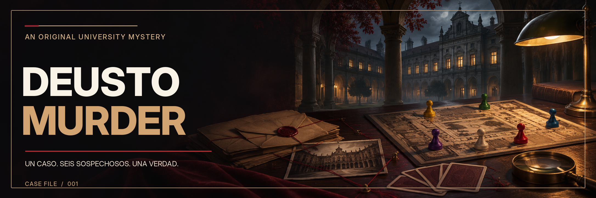
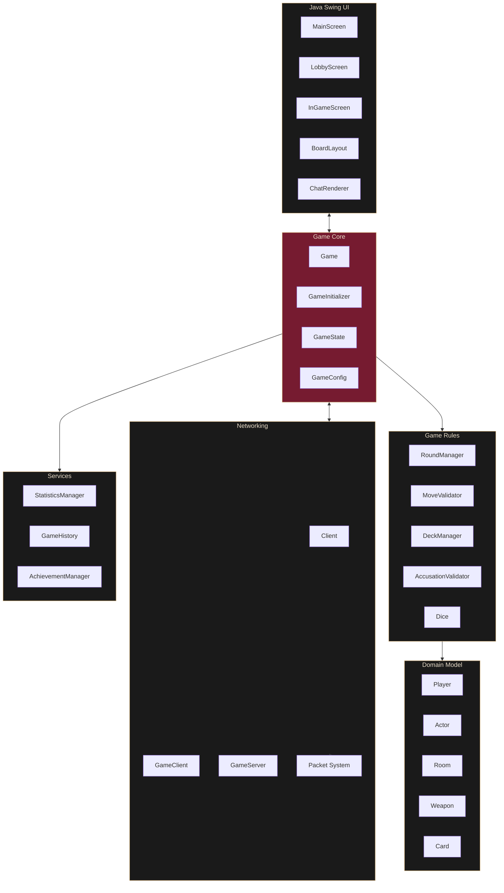
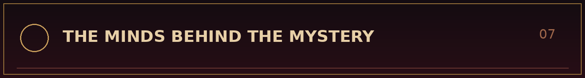

<div align="center">



<br>

# DEUSTO MURDER

**ONE MURDER. SIX SUSPECTS. ONE TRUTH.**

*An atmospheric multiplayer detective board game inspired by Cluedo, built with Java 21 and Swing.*

<br>

[](https://www.java.com/)
[](https://docs.oracle.com/javase/21/docs/api/javax/swing/package-summary.html)
[](https://github.com/Finse2/DeustoMurder)
[](https://github.com/Finse2/DeustoMurder/issues)

<br>

[The Case](#the-case) · [How to Play](#how-to-play) · [Gallery](#inside-the-mystery) · [Features](#features) · [Architecture](#under-the-hood) · [Getting Started](#getting-started) · [Roadmap](#development-roadmap) · [Team](#the-minds-behind-the-mystery)

</div>

---

<a id="the-case"></a>

<div align="center">


</div>

<br>

> *Every suspect has a secret. Every clue tells a story.*

A mysterious murder has shaken the **University of Deusto**. Step into the role of a detective, investigate the board, examine the cards, and piece together the truth before your opponents do.

The game takes place across **10 rooms** of the university — from the CRAI library to the DeustoTech labs. Six suspects roam the halls, each wielding one of six possible weapons. Your mission is simple but unforgiving: discover **who** committed the crime, **where** it happened, and **which weapon** was used.

<table>
<tr>
<td width="33%" align="center"><strong>INVESTIGATE</strong><br><sub>Explore the board and examine the evidence.</sub></td>
<td width="33%" align="center"><strong>DEDUCE</strong><br><sub>Rule out suspects, rooms and weapons.</sub></td>
<td width="33%" align="center"><strong>ACCUSE</strong><br><sub>Make your final accusation.</sub></td>
</tr>
</table>

<br>

<hr>

<a id="how-to-play"></a>

<div align="center">


</div>

<br>

> *Follow the clues. Eliminate the impossible. Uncover the truth.*

### 01 · Join the Investigation

Host a game from the main menu or join an existing session using a server code. The lobby supports up to **6 players**, each controlling a unique detective piece on the board.

### 02 · Roll & Move

On your turn, roll **two six-sided dice** and move your piece across the board. Navigate through corridors, enter rooms, and position yourself strategically to gather information.

### 03 · Examine the Evidence

Each player receives **4 cards** at the start of the game. Use your hand and detective notes to eliminate impossible combinations of suspect, room, and weapon. A built-in **chat system** lets you communicate with other players.

### 04 · Solve the Case

When you're confident, make your accusation. Identify the suspect, the weapon, and the room — if all three match the secret solution, you win. A wrong accusation ends the game and crowns another player as the victor.

> **Note:** The project is under active development. Some multiplayer and gameplay features may not yet be fully integrated or tested end-to-end.

<br>

<hr>

<a id="inside-the-mystery"></a>

<div align="center">


</div>

<br>

> *A glimpse behind the investigation.*

<p align="center"><em>Gameplay screenshots will be added as the interface is finalized.</em></p>

<br>

<hr>

<a id="features"></a>

<div align="center">

### FEATURES

</div>

<br>

### Implemented

- **Game Core** — Complete game lifecycle with state management, initialization, and configuration (`Game`, `GameState`, `GameInitializer`, `GameSetup`).
- **Turn System** — Round-based turns with timer support, dice rolling, and movement validation (`RoundManager`, `MoveValidator`, `Dice`, `TurnTimerThread`).
- **Card System** — Deck shuffling, card distribution, and remaining card management (`DeckManager`).
- **Accusation Validation** — Solution verification comparing player accusations against the secret solution (`AccusationValidator`).
- **Board & Movement** — 23×22 grid board with 10 rooms, entrance detection, and piece movement (`BoardLayout`, `Tile`, `Room`, `Piece`).
- **Networking** — TCP/IP client-server architecture with packet-based communication (`GameClient`, `GameServer`, `Client`, `Packet`, `PacketType`).
- **Lobby System** — Player roster management, server code sharing, and connection handling (`LobbyScreen`, `LobbyControl`, `LobbyRoster`, `ServerCode`).
- **Chat** — In-game messaging with network synchronization (`Chat`, `ChatHistory`, `ChatRenderer`).
- **Game History** — Event recording, filtering, CSV export/import, and change listeners (`GameHistory`, `GameEvent`).
- **Statistics** — Player statistics tracking, leaderboard, and CSV export (`StatisticsManager`, `PlayerStatistics`, `ProfileMatchTracker`).
- **Achievements** — Achievement types, levels, and management system (`Achievement`, `AchievementType`, `AchievementLevel`, `AchievementManager`).
- **UI Screens** — Main menu with animated background, lobby, in-game screen with zoom, winner screen (`MainScreen`, `LobbyScreen`, `InGameScreen`, `WinnerScreen`).
- **Sound Effects** — Audio feedback for game actions (`SoundEffect`).
- **Persistence** — Profile picture storage and JDBC database manager (`DBManager`, `JDBCDependencyHandler`).

### In Progress

- **Full multiplayer game flow** — End-to-end integration of networking with game logic for a complete online experience.
- **Achievements UI integration** — Displaying achievements and progress in the player interface.
- **Save/Load game state** — Persistent game history and the ability to resume interrupted sessions.

### Planned

- **Advanced matchmaking** — Room browser and automated player matching.
- **Custom boards** — User-defined room layouts and themes.
- **Replay system** — Record and review past games.
- **Accessibility options** — Colorblind modes, font scaling, and keyboard navigation improvements.

<br>

<div align="center"></div>

<a id="under-the-hood"></a>

<div align="center">


</div>

<br>

> *The engineering behind the mystery.*

DeustoMurder follows a modular, object-oriented architecture that cleanly separates the user interface, game rules, networking, and supporting services. The codebase is organized into well-defined packages, each responsible for a distinct domain.



### Package overview

| Package | Key classes | Responsibility |
|:--|:--|:--|
| `app` | `Main` | Application entry point |
| `game.core` | `Game`, `GameState`, `GameInitializer`, `GameSetup`, `GameConfig` | Game lifecycle, state, initialization, and configuration |
| `game.turns` | `RoundManager`, `MoveValidator`, `DicePathfinder`, `TurnTimerThread` | Turn order, movement validation, and timing |
| `game.cards` | `DeckManager` | Deck shuffling and card distribution |
| `game.accusations` | `AccusationValidator` | Solution verification |
| `game.dice` | `Dice`, `GameRandomizer` | Dice rolling and randomization |
| `game.history` | `GameHistory`, `GameEvent`, `GameHistoryWriterThread` | Event recording, filtering, and CSV persistence |
| `game.statistics` | `StatisticsManager`, `PlayerStatistics`, `ProfileMatchTracker` | Player stats, leaderboard, and CSV export |
| `game.achievements` | `Achievement`, `AchievementType`, `AchievementLevel`, `AchievementManager` | Achievement tracking and progression |
| `model` | `Player`, `Actor`, `Room`, `Weapon`, `Card`, `Piece` | Domain entities and game objects |
| `model.board` | `BoardFactory`, `Tile`, `RawRoom`, `RawPiece` | Board data structures |
| `Networking` | `Client`, `GameClient`, `GameServer`, `Packet`, `PacketType` | TCP/IP communication and packet protocol |
| `ui.match` | `BoardLayout`, `CardRenderer`, `DetectiveCard` | Board rendering and card visuals |
| `ui.match.inGameScreen` | `InGameScreen`, `DiceRollPanel`, `GameActionsPanel`, `WinnerScreen` | In-game UI panels and screens |
| `ui.chat` | `Chat`, `ChatHistory`, `ChatRenderer` | Chat system and message rendering |
| `activation.Screen` | `MainScreen`, `LobbyScreen`, `AnimatedBackGround` | Menu screens and animations |
| `utils` | `AllFonts`, `AllThemes`, `AllPaths`, `DBManager` | Shared utilities, theming, and database access |

### Source layout

```text
innerProy/src/
├── app/                        # Entry point
├── game/
│   ├── core/                   # Game lifecycle & state
│   ├── turns/                  # Turn & movement logic
│   ├── cards/                  # Deck management
│   ├── accusations/            # Solution validation
│   ├── dice/                   # Dice & randomization
│   ├── history/                # Event history
│   ├── statistics/             # Player statistics
│   └── achievements/           # Achievement system
├── model/                      # Domain entities
│   └── board/                  # Board data structures
├── Networking/                 # TCP/IP communication
│   ├── client/
│   ├── server/
│   ├── common/
│   └── packets/
├── ui/
│   ├── match/                  # Board & card rendering
│   │   ├── inGameScreen/       # In-game panels
│   │   └── cardDisplayer/      # Card hand display
│   └── chat/                   # Chat system
├── activation/
│   └── Screen/                 # Menu & lobby screens
│       └── Lobby/
├── utils/                      # Shared utilities
│   └── JDBC/                   # Database access
└── achievements/               # Legacy achievement classes
```

<br>

<div align="center"></div>

<a id="getting-started"></a>

<div align="center">


</div>

<br>

> *Every investigation begins somewhere.*

### Requirements

- **Java Development Kit (JDK) 21** or later.
- **IntelliJ IDEA** (recommended) or any compatible IDE.
- **Git** to clone the repository.

### Step 01 — Clone the repository

```bash
git clone https://github.com/Finse2/DeustoMurder.git
cd DeustoMurder
```

### Step 02 — Open in IntelliJ IDEA

1. Launch **IntelliJ IDEA** and select **File → Open**.
2. Navigate to the cloned `DeustoMurder` directory and open it.
3. IntelliJ will detect the project structure automatically.

### Step 03 — Configure the SDK

1. Go to **File → Project Structure → Project**.
2. Set the **SDK** to **JDK 21** (or a compatible version).
3. Ensure the **Language level** is set to **21**.
4. Mark `innerProy/src` as the **Sources Root** if it isn't already.

### Step 04 — Run the application

1. Open `innerProy/src/app/Main.java`.
2. Click the **Run** button or press `Shift + F10` (Windows/Linux) / `Ctrl + R` (macOS).
3. The main menu will appear with an animated background.

### Step 05 — Start a game

1. From the main menu, select **Host Game** to create a new session.
2. Enter your name and start the lobby.
3. Share the generated server code with other players.
4. Once players have joined, start the game from the lobby.

### Step 06 — Connect as a player

1. From the main menu, select **Join Game**.
2. Enter the server code shared by the host.
3. The client will connect to the host's lobby automatically.

<details>
<summary><strong>Troubleshooting</strong></summary>

- **JDK not configured:** Select a compatible SDK in IntelliJ's Project Structure.
- **Sources not recognized:** Right-click `innerProy/src` in the project view and select **Mark Directory as → Sources Root**.
- **Resources missing:** Verify that the working directory in the run configuration points to the project root.
- **Multiplayer connection fails:** Ensure the host is running, both players are on the same network, and the firewall allows the connection on the specified port.
- **Animated background not loading:** Check that the `innerProy/ressources/MenuFrames1` directory exists and contains the frame images.

</details>

<br>

<div align="center"></div>

<a id="development-roadmap"></a>

<div align="center">


</div>

<br>

> *Building the mystery, one commit at a time.*

### Completed

- [x] Core game model with state management and lifecycle
- [x] Turn system with dice rolling and movement validation
- [x] Card deck management and distribution
- [x] Accusation validation against secret solution
- [x] Board layout with 10 rooms and piece movement
- [x] TCP/IP networking with packet-based protocol
- [x] Lobby system with player roster and server codes
- [x] In-game chat with network synchronization
- [x] Game history with event recording and CSV export
- [x] Player statistics with leaderboard and CSV export
- [x] Achievement system with types and levels
- [x] Main menu with animated background
- [x] In-game screen with zoom and scroll
- [x] Sound effects for game actions
- [x] Profile picture management
- [x] JDBC database manager foundation

### In Progress

- [ ] End-to-end multiplayer game flow integration
- [ ] Achievements UI integration
- [ ] Save/load game state persistence

### Planned

- [ ] Advanced matchmaking and room browser
- [ ] Custom board editor
- [ ] Replay system
- [ ] Accessibility improvements
- [ ] Comprehensive test suite
- [ ] Release packaging and distribution

<br>

<div align="center"></div>

<a id="the-minds-behind-the-mystery"></a>

<div align="center">



</div>

<br>

> *Four developers. One investigation.*

Developed as a student project at the **University of Deusto**.

| Developer | Primary focus |
|:--|:--|
| **David Balsategui Gil** | Game logic, backend systems, and gameplay architecture |
| **Andrada Rebeca Nan** | Multiplayer lobby, networking, and player experience |
| **Antal Janos Nistal Toth** | Board rendering, interface components, and visual design |
| **Luka Arévalo Douchet** | Main interface, board visualization, and UI integration |

<div align="center">

[**View repository contributors**](https://github.com/Finse2/DeustoMurder/graphs/contributors)

</div>

<br>

<div align="center"></div>

<div align="center">


<br>

# THE CASE IS NEVER TRULY CLOSED.

*Every mystery leaves a trace.*

<br>

[](https://github.com/Finse2/DeustoMurder)
[](https://github.com/Finse2/DeustoMurder/issues)
[](https://github.com/Finse2/DeustoMurder/graphs/contributors)

<br>

<sub>DEUSTO MURDER · UNIVERSITY OF DEUSTO · 2026</sub>

</div>
